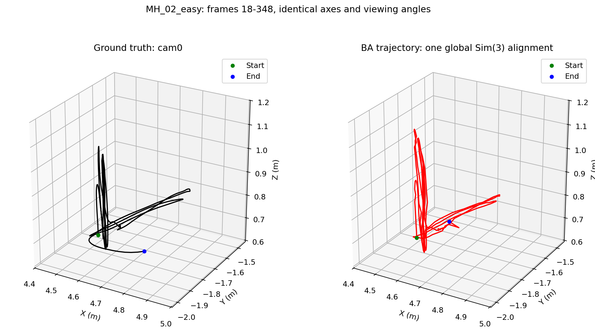
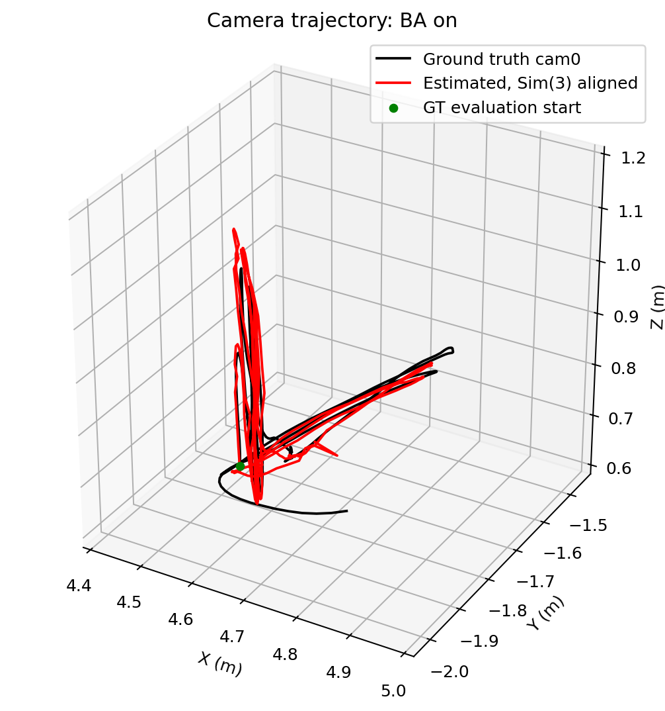
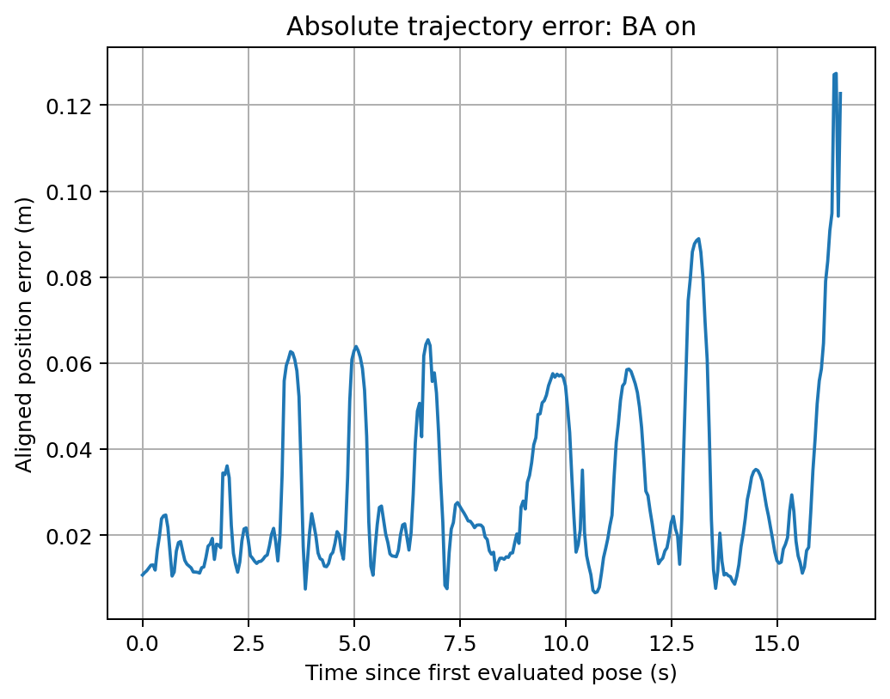
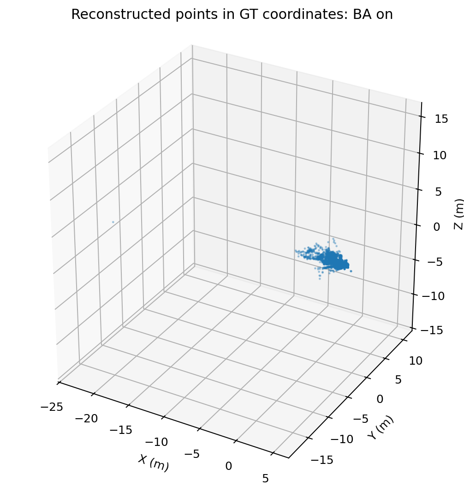

# Monocular visual odometry: MH_02_easy

The pipeline uses ORB matching, essential-matrix initialization, triangulation,
PnP pose estimation, and optional local bundle adjustment (BA). It returns a
camera trajectory and a list of 3D point tuples. Loop closure and relocalization
are not implemented.

## Current evaluation

This report records the saved results in
[`evaluation/ba_on/metrics.json`](evaluation/ba_on/metrics.json).
These numbers describe the successfully tracked segment, not the full dataset.

| Evaluation setting | Value |
| --- | --- |
| Sequence | EuRoC Machine Hall 02 (`MH_02_easy`), `cam0` |
| BA | Enabled |
| Initialization frames | 0 and 10 |
| Last successfully tracked frame | 348; tracking lost at frame 349 |
| Estimated poses | 340 of 3,040 dataset images, approximately 11.2% |
| Evaluated frames | 18–348 |
| Timestamp-matched poses | 331 |
| Evaluated duration | 16.50 s |
| Estimated poses excluded without GT coverage | 9 |
| GT traveled distance in evaluated interval | 5.8555 m |
| Aligned estimated traveled distance | 6.2031 m |
| Alignment scale | 0.103757 m per estimated unit |

Ground-truth quaternions are read in EuRoC's `w, x, y, z` order and converted
to SciPy's `x, y, z, w` order. Ground-truth body poses are converted to camera
poses with the `T_BS` transform in `cam0/sensor.yaml`:

```text
T_reference_camera = T_reference_body @ T_body_camera
p_reference_camera = p_reference_body + R_reference_body @ t_body_camera
```

Timestamps are read as integer nanoseconds. Body positions are interpolated
linearly and orientations using quaternion SLERP, with zero timestamp offset,
no extrapolation, and a maximum interpolation gap of 0.02 s.

One global Sim(3) transform is fitted to all matched estimated camera centers.
The same scale, rotation, and translation are applied throughout the interval.
This removes the initial monocular scale/orientation/origin ambiguity; it does
not recover independently measured metric scale or remove changing scale drift.

## Error metrics with BA

| Metric | Saved result |
| --- | ---: |
| Absolute position error (ATE), RMSE | 0.037107 m |
| ATE mean | 0.030197 m |
| ATE median | 0.021623 m |
| ATE standard deviation | 0.021566 m |
| ATE 95th percentile | 0.067533 m |
| ATE maximum | 0.127348 m |
| Aligned endpoint position error | 0.122680 m |
| Absolute orientation RMSE after alignment | 3.5602 degrees |
| Relative translation RMSE, approximately 1 s intervals | 0.058256 m |
| Relative rotation RMSE, approximately 1 s intervals | 3.6225 degrees |
| Relative-pose evaluation pairs | 311 |

ATE measures the Euclidean distance between aligned estimated and GT camera
positions. Relative pose error (RPE) compares camera-to-camera motion over
1 s, with a timestamp tolerance of 0.025 s. Endpoint error is the final aligned
position error, not an independently measured percentage drift.

The position fit is reasonably close over this short segment, but tracking
failure and reconstruction outliers remain unresolved. These metrics do not
establish the accuracy of the entire sequence or of the reconstructed map.

## 3D ground truth and BA trajectory

Both panels below use identical axes and viewing angles. Green marks the first
evaluated pose; blue marks the last. The BA trajectory is globally aligned to GT.



The overlay makes deviations between the same timestamp-matched poses visible:



### Position error over time



### Reconstruction diagnostic

The point cloud is transformed with the same Sim(3) alignment. Isolated distant
points stretch the plot axes. This is a visualization of the estimated map,
not a comparison against ground-truth scene geometry.



## Improvements in priority order

These are proposed changes; they have not been implemented by this report.

| Priority | Improvement | Current issue and verification |
| --- | --- | --- |
| 1 | Preserve geometric inlier masks | `findEssentialMat` and `recoverPose` masks are discarded. Carry them through initialization and triangulation; measure geometric inlier counts and initialization stability. |
| 2 | Strengthen PnP validation | An absolute minimum of 15 inliers does not enforce a useful inlier fraction or image coverage. Log counts, ratios, spatial distribution, and reprojection-error percentiles; validate again after refinement. |
| 3 | Restrict map matching using geometry | Matching searches the full landmark descriptor list. Use predicted visibility, image-position gating, and a local map to reduce ambiguous associations. |
| 4 | Add landmark validation and culling | Points can enter the map after two-view checks without persistent support. Track observation counts, parallax, and later reprojection consistency; remove repeatedly inconsistent points and merge verified duplicates. |
| 5 | Fix BA pose coverage | BA runs every 10 frames over a 5-frame window and fixes its oldest two poses. Only the last three poses are adjustable per call, leaving gaps. Use overlapping optimization windows or keyframe scheduling that covers all intended poses. |
| 6 | Improve BA constraints and landmark selection | Fixing two entire poses preserves scale but also locks their errors. Review gauge constraints and select well-supported landmarks with spatial coverage; the current 500-point cap does not optimize the entire map. |
| 7 | Make BA diagnostics complete | Print robust cost, ordinary RMSE, observation count, solver termination, evaluation count, and rejection reason for every call. Check geometry outside the optimized subset as well. |
| 8 | Validate predictions on later frames | Test triangulated points against observations not used to create or optimize them. Low error in their creation images is insufficient evidence of accurate depth. |
| 9 | Improve initialization checks | Feature displacement can also arise from rotation. Add explicit parallax, cheirality, and geometric-model checks; test sensitivity to the starting frame. |
| 10 | Improve GT evaluation and comparison | Compare BA on/off over exactly the same timestamps. Add XYZ-versus-time plots, segment errors, coverage, and an initial-segment-only alignment to expose later drift. |
| 11 | Add keyframes and recovery | Use keyframes/local maps to control growth and introduce relocalization when tracking fails. Evaluate successful tracking duration as well as trajectory error. |
| 12 | Add loop closure and global optimization | After local tracking is reliable, add verified loop candidates, pose-graph optimization, and appropriate global BA. Monocular metric scale still requires an external reference. |

## Interpreting BA logs

```text
Local BA: reprojection RMSE 0.796 -> 0.443 px
Local BA: reprojection RMSE 0.769 -> 0.424 px
```

Each line compares before/after errors for one selected optimization problem.
The next call uses different frames and observations, so its starting RMSE
need not continue downward from the previous call's final RMSE.

The printed RMSE averages squared horizontal and vertical residual components
over `2 * number_of_observations`. The optimizer minimizes a robust soft-L1
objective, so the logged ordinary RMSE is not the exact optimization cost.
The implementation currently prints accepted updates only. Small local
reprojection error does not prove correct depth, scale consistency, or tracking.

## BA-off results are from a different interval

The existing [`evaluation/ba_off/metrics.json`](evaluation/ba_off/metrics.json)
covers frames 18–79, only 62 evaluated poses over 3.05 s. Its position RMSE is
0.067562 m. This cannot be directly compared with the 16.50 s BA-on report.
Its absolute orientation RMSE is 173.136 degrees; inspect alignment conditioning
and relative rotation errors before attributing this to a physical camera flip.

## Running the evaluation

```bash
python test.py
python test.py --no-ba
```

`test.py` follows `USE_BUNDLE_ADJUSTMENT` in `main.py` unless `--ba` or `--no-ba`
is supplied. It shows plots and saves metrics, a matched trajectory CSV, and
figures under `evaluation/ba_on` or `evaluation/ba_off`.

For an initial comparison with the same requested interval:

```bash
python test.py --ba --end-frame 80
python test.py --no-ba --end-frame 80
```

If either run loses tracking, restrict both reports to their shared successful
timestamps. Running evaluations overwrites their respective saved results;
the numeric tables above are a snapshot of the report described here.

The separate-panel figure was generated from the saved BA-on `trajectory.csv`.
`test.py` currently regenerates the trajectory overlay, point cloud, and error
plot; the separate-panel figure must be refreshed if the evaluated run changes.
