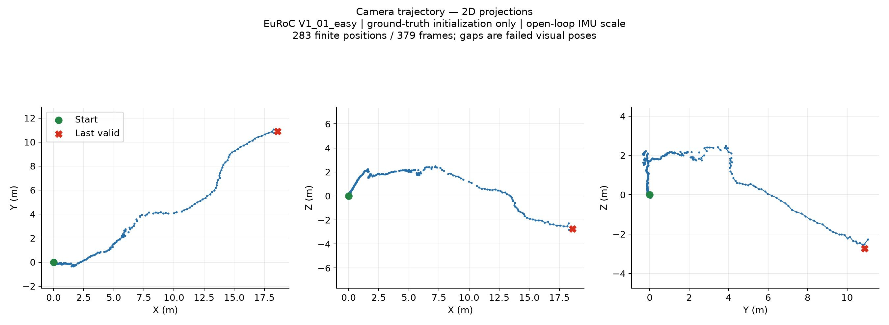
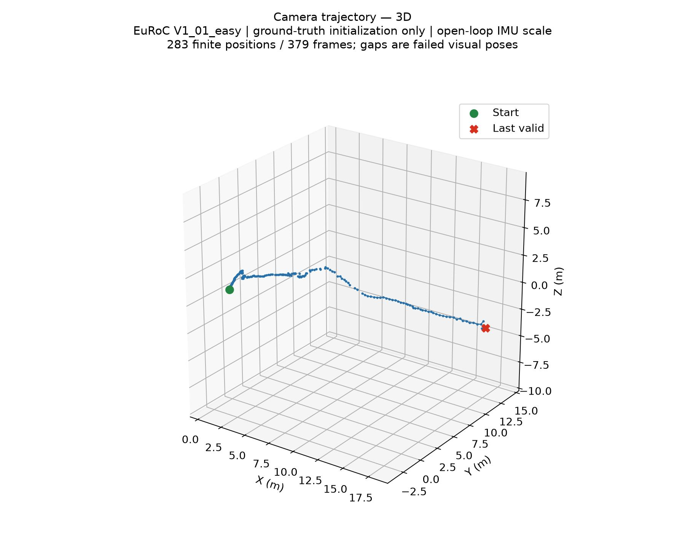

# Camera motion estimation

A small C++ project for estimating camera motion from images and IMU readings using OpenCV. It matches ORB features between frames, estimates the essential matrix with RANSAC, and recovers the camera pose. An IMU integrator estimates the distance between frames. Positions are saved to `trajectory.csv`.

## Sample trajectory

EuRoC `V1_01_easy`, using the first ground-truth state to initialize IMU orientation, velocity, and biases. Of the 400 sample images, 21 precede initialization. The remaining 379 frames produced 283 finite positions and 96 failed poses, shown as gaps.

The plots show the estimated camera trajectory in meters relative to the first processed camera pose. This run uses open-loop IMU scale; its accuracy has not been validated against ground truth.





## Setup

You need a C++17 compiler, CMake 3.16 or newer, and the OpenCV 4 C++ libraries.

On Ubuntu / Debian:

```sh
sudo apt update
sudo apt install build-essential cmake libopencv-dev
```

On macOS, install the Xcode command line tools, then:

```sh
brew install cmake opencv
```

On Windows, install Visual Studio with the **Desktop development with C++** workload, CMake, and OpenCV 4 for your compiler and architecture.

## Build

Run these commands from the repository root:

```sh
cmake -S . -B build -DCMAKE_BUILD_TYPE=Release
cmake --build build --config Release --parallel
```

CMake finds OpenCV automatically. If it cannot find your installation, set `OpenCV_DIR` to the folder containing `OpenCVConfig.cmake`:

```sh
cmake -S . -B build -DOpenCV_DIR="/path/to/opencv/cmake/directory"
```

Use a fresh build directory when switching computers or compilers.

## Run

Put your PNG frames and EuRoC-format IMU readings in `data/`:

```text
data/
  1403715273262142976.png
  1403715273312143104.png
  imu0/
    data.csv
  imu_initial.yaml
```

Image filenames must be integer timestamps in nanoseconds, on the same clock as the IMU. The IMU CSV columns are `timestamp_ns,wx,wy,wz,ax,ay,az` (rad/s and m/s²); lines starting with `#` are skipped.

Create `data/imu_initial.yaml` using `imu_initial.example.yaml` as a format reference. Supply the initial IMU-to-world rotation, world velocity, gravity, gyro and accelerometer biases, and the camera position in IMU coordinates. The template values are placeholders, not an initialization for the sample dataset. Its timestamp must be covered by the IMU readings. Images before initialization are excluded; output frame indices start at the first remaining image.

Run from the repository root:

```sh
./build/camera_motion
```

With Visual Studio, the executable is usually at `build/Release/camera_motion.exe`.

The program writes `trajectory.csv` in the current directory, with columns `frame,x,y,z`. The first position is the origin. Frames where pose recovery fails have `nan` coordinates; the reason is printed in the terminal.

The calibration in `main.cpp` is for the left camera in EuRoC MAV. Change the camera matrix, distortion coefficients, and IMU-to-camera calibration if you use another sensor.

`imu.cpp` integrates angular velocity and gravity-compensated acceleration while retaining velocity between frames. `stepScale(previousFrame, currentFrame)` returns the net camera displacement in meters, including the camera's offset from the IMU. If visual pose recovery fails, the next scale spans the interval from the last successful frame.

This is open-loop IMU integration, not a full visual-inertial estimator. Incorrect initial velocity, orientation, or biases cause drift; metric units do not guarantee an accurate trajectory. Don't assume zero initial velocity unless the sensor was stationary. Missing IMU coverage, out-of-order timestamps, and gaps larger than 20 ms are rejected rather than replaced with a made-up scale.

Image sequences and generated CSV files are ignored by Git and are not included when you clone the repo.

Run the synthetic integration checks with:

```sh
ctest --test-dir build --output-on-failure
```

## VS Code

Install the recommended **C/C++** and **CMake Tools** extensions. Run **CMake: Configure**, choose your compiler, then **CMake: Build**. The included settings let IntelliSense use the OpenCV paths found by CMake.

## Local debug demo

If you have `debug.cpp` and `airport.jpg`, you can also build the ORB matching demo:

```sh
cmake -S . -B build -DBUILD_DEBUG_DEMO=ON
cmake --build build --config Release --parallel
./build/debug_demo
```

It opens a window showing matches between the image and a translated copy. The demo is off by default, and its source, binaries, and image assets are ignored by Git.
